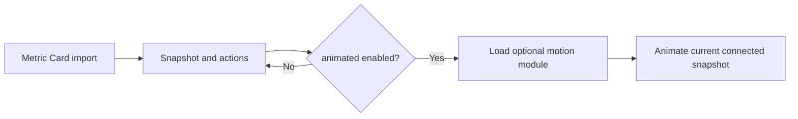

# Insight charts

These components display host-owned observations. They do not fetch files,
calculate business KPIs, infer desirable direction, or manufacture scoped actions.
The docs use explicitly illustrative data. All seven framework examples preserve
the same values, markup, and variant.

## Reading order and composition

The shared bar/line/chart-panel shell presents title and scope, optional inspection,
evidence, then table/reset controls and a source/method note. `summary`, `legend`,
`actions` and inspection are optional. A single series needs no legend. Slots named
`header`, `inspection` and `footer` accept host-owned additions. BoxPlot,
MetricCard and DistributionTimeline also expose a footer slot. Use `::part()` and `--boe-chart-ink`,
`--boe-chart-muted`, `--boe-chart-history` for local theming. Focus and selection
have distinct outlines; selected marks also say “Selected”.

## Ordered observations and inspection

`points` preserves host order. Each point has `id`, `label`, `value` (number or
null), optional `tone`, `partial`, and optional `inspection: {label, value,
comparison}`. The host supplies this copy because its period, aggregation and
comparison semantics are domain-specific. `unit` labels the value axis; `x-label`
labels the categories. `domain` optionally supplies containing minimum/maximum
bounds; values are never silently clipped. Line charts are straight observed
segments; null intervals retain their place and break the line.

Click, Enter or Space selects a point, reflects `selected-id` / `selectedId`,
and emits the existing `point-selected` payload. Hosts may set this ID directly.
Clear selection removes it, emits `selection-cleared`, and returns inspection
to the latest supplied interval. No default comparison is invented. Comparisons
are suppressed for incomplete/missing current or preceding observations, or
`state="partial"`. The scale and category order do not change on selection.
The table preserves missing, measured-zero and incomplete values separately.

Use `state="loading"`, `error`, `partial`, or `stale` and `status-message` for
coverage and timestamp details; the default is ready. An empty array means no
observations, while a numeric zero is a measurement. Loading/error hide cached
values; loading retains a blank geometry region. Stale data remains visible
with a status. The host supplies retry controls or actions. Do not add a button
unless its result and period scope are actually implemented. The illustrative
examples deliberately omit drill-down actions because they have no file source.

## Composition and stock metrics

Donut charts show parts of one total, with exact values and shares in a semantic
table. The recommended static example sets `readonly` / `readOnly`; interactive
legend selection remains available for compatibility when that attribute is
absent. `unit`, `total-label` and `note` explain the total. Optional `total` fixes
the denominator when classifications are incomplete; the unclassified remainder
stays visible as track and as an Unclassified table row, with disclosure. An inconsistent smaller denominator is
not used to overstate shares. Rounded percentages and invalid categories are
explicitly disclosed. A zero amount and no observations are different states.

MetricCard is a snapshot, not a sum over an implied time window. Its eyebrow
can name the as-of date; `trend.label` names the comparison date and baseline.
The demo's +182 (+16.5%) is neutral: an increase alone does not establish success.
Loading/error/partial/stale use `state` and `status-message`; invalid comparisons
are hidden. A source definition belongs in `message` or a footer slot.

## Export and enlarged text

Preserve the title, scope, inspection, exact-value table and source/method note
when exporting a chart. An SVG-only ring or line omits essential context from
the surrounding HTML. Capture the whole component or render a host-owned export
from the same observations. At enlarged text sizes, tables may scroll within
the card; an export must include all columns rather than only the viewport.
The local review images show the default full component; no export API is added.

## Compatibility and design changes

Existing tags, imports, events, tone overrides and property setters remain.
Bar/line selection now reflects an ID and pressed state; history is gray and
the focal interval is blue. Explicit tone overrides retain their meaning.
Actions move to the footer. Inspection copy is opt-in, so existing summary-only
consumers remain usable. The point value type now permits null for missing observations; TypeScript event handlers must guard `value === null` before arithmetic. New properties require the next library release; no version is bumped in this local design phase. Donut data is now a native table rather than a layout
list; the `legend-*` styling parts remain. The distribution tables intentionally
use four priority columns with quartiles/extremes in disclosure.

DistributionTimeline follows the same contract for a run rather than a category:
`state`, `status-message` and `domain` behave as above, and `selectable` opts into
interval inspection, which reflects `selected-id` and emits `interval-selected`.
Because a run can hold hundreds of intervals, its marks are one tab stop with the
arrow keys moving between them rather than one tab stop each.

Automated accessibility checks are not a manual screen-reader pass. Design
acceptance is a separate review of rendered desktop/mobile output against the
approved component studies, including density, hierarchy and interaction meaning.

## Metric summaries on the page canvas

`box-metric-card` accepts `variant="plain"` to remove card padding, border,
radius and background. `emphasis="primary"` enlarges the value to 3rem without
changing its status tone. Both work with `size="compact"`; their default is
`"default"`. Values use tabular numerals in every variant. Host CSS can add
dividers through `::part(card)` when figures share a row.

```html
<box-metric-card heading="Successful runs" value="1,234"
  variant="plain" emphasis="primary" size="compact" tone="success">
</box-metric-card>
```

## Metric Card loading and footer

A static `box-metric-card` loads no chart runtime or chart stylesheet. Its existing
`animated`, `animation-*`, `replayAnimation()` and `finishAnimation()` controls
remain supported. Opting into animation fetches the motion module asynchronously;
the current snapshot and action remain usable while it loads, or if that optional
fetch fails. Removing or disabling the card during loading prevents motion setup.



The internal `footer` part is hidden when it has no action and no visible trend,
removing its divider and grid gap. Adding an action or a visible trend shows it
again. Trends suppressed by loading/error/partial data states do not keep an
empty footer open; an action still does. The separate `slot="footer"` remains
available for host content.

Run `node tools/preview/metric-card-bundle.mjs` after `bun run build:core` to check
the isolated production entry (18,000 bytes / 5,500 gzip maximum), the absence of
eager chart modules, and the deferred animation chunk.
